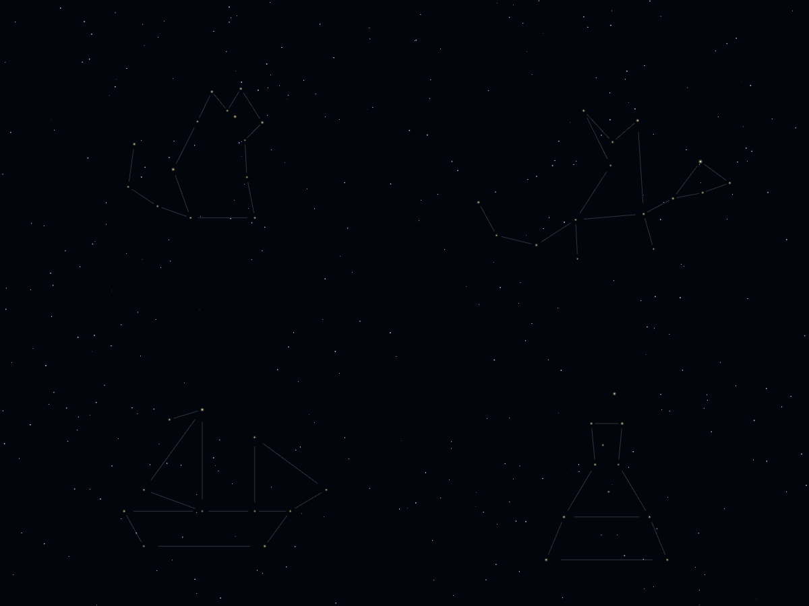

# Night-sky constellations

Four original constellations hang in the Brain's night sky: **the Cat**, **the Dragon**, **the Pirate Ship** and **the Flask**.

| Figure | Brightest star | Right ascension | Declination |
| --- | --- | --- | --- |
| The Cat | the Cat's Eye | 20° | +8° |
| The Dragon | the Dragon's Crown | 110° | −6° |
| The Pirate Ship | the Lookout (main top) | 200° | +10° |
| The Flask | the Spark (escaping bubble) | 290° | −10° |

## How it works

- Charts live in `src/lib/brain/constellations.ts`: stars in degrees on a flat chart (x east, y north), pinned to a fixed world direction like the background stars in `galaxy.ts`.
- Earth spins under them on the shared pose clock (`getEarthPoseTime`), so every peer sees each figure rise and set at the same moment. Nothing reads a frame counter or `Date.now()`.
- They sit near the celestial equator a quarter turn apart, so at least two are up on any night of the year.
- `src/components/brain/Constellations.tsx` draws them with two draw calls (Points and LineSegments) baked once at mount, inside the Brain scene's render loop. Per frame it only follows the camera and writes uniforms. Opacity comes from `skyCadenceAt(...).starOpacity`, the same value as the background stars, and the figure lines fade in only once the sky is properly dark.
- The twinkle runs on the shared clock folded into a 600 s period (`twinkleTime`), so peers twinkle together and float32 precision holds.
