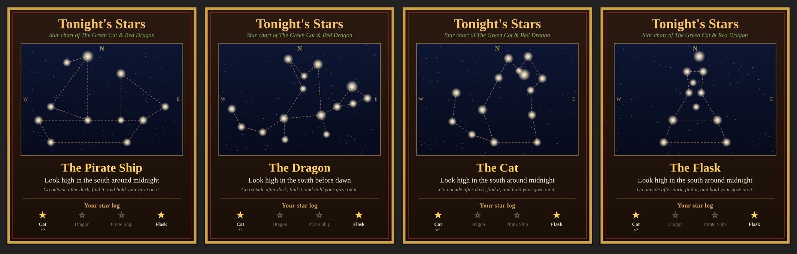

# Night-sky constellations

Four original constellations hang in the Brain's night sky: **the Cat**, **the Dragon**, **the Pirate Ship** and **the Flask**.

| Figure | Brightest star | Right ascension | Declination |
| --- | --- | --- | --- |
| The Cat | the Cat's Eye | 20° | +8° |
| The Dragon | the Dragon's Crown | 110° | −6° |
| The Pirate Ship | the Lookout (main top) | 200° | +10° |
| The Flask | the Spark (escaping bubble) | 290° | −10° |

## How it works

- Charts live in `src/lib/brain/constellations.ts`: stars in degrees on a flat chart (x east, y north), pinned to a fixed world direction like the background stars in `galaxy.ts`.
- Earth spins under them on the shared pose clock (`getEarthPoseTime`), so every peer sees each figure rise and set at the same moment. Nothing reads a frame counter or `Date.now()`.
- They sit near the celestial equator a quarter turn apart, so at least two are up on any night of the year.
- `src/components/brain/Constellations.tsx` draws the stars only, with one draw call baked once at mount, inside the Brain scene's render loop. There are no figure lines in the sky, and the figures' stars are only a little brighter than the background stars (2.6–4.2 px against 1–2.6 px): finding them is the game. Opacity comes from `skyCadenceAt(...).starOpacity`, the same value as the background stars.
- The twinkle runs on the shared clock folded into a 600 s period (`twinkleTime`), so peers twinkle together and float32 precision holds.

## Star hunt

The game behind the constellations (`src/lib/brain/starHunt.ts`, state in `starHuntStore.ts`).

1. **Read the chart.** A star chart hangs on the west wall inside The Green Cat & Red Dragon, to the left of the dartboard (`StarChartBoard.tsx`). It shows tonight's constellation with its figure lines, north up, and a loose hint such as "Look high in the south around midnight". Standing within 6 m of it opens tonight's hunt.
2. **Go outside after dark.** Tonight's figure is one that stands at least 20° up after dark from the village. It's chosen by a hash of the night, so the nights vary and every peer gets the same chart. Nights run noon to noon at the village, so the chart never changes in the dark.
3. **Find it and hold your gaze.** Keep the centre of the screen within 7° of the figure's centre for 2.2 s. The hold ring only appears after 0.8 s already on target, so sweeping the sky doesn't work as a metal detector. The find doesn't count indoors, below 10° altitude, or before the stars are out.
4. **Star log.** Each find is logged once per night, on this device only, and the chart shows your log. Logging all four makes you a Star Navigator.

The difficulty dials are the constants at the top of `starHunt.ts` and the point size and alpha in `Constellations.tsx`.
